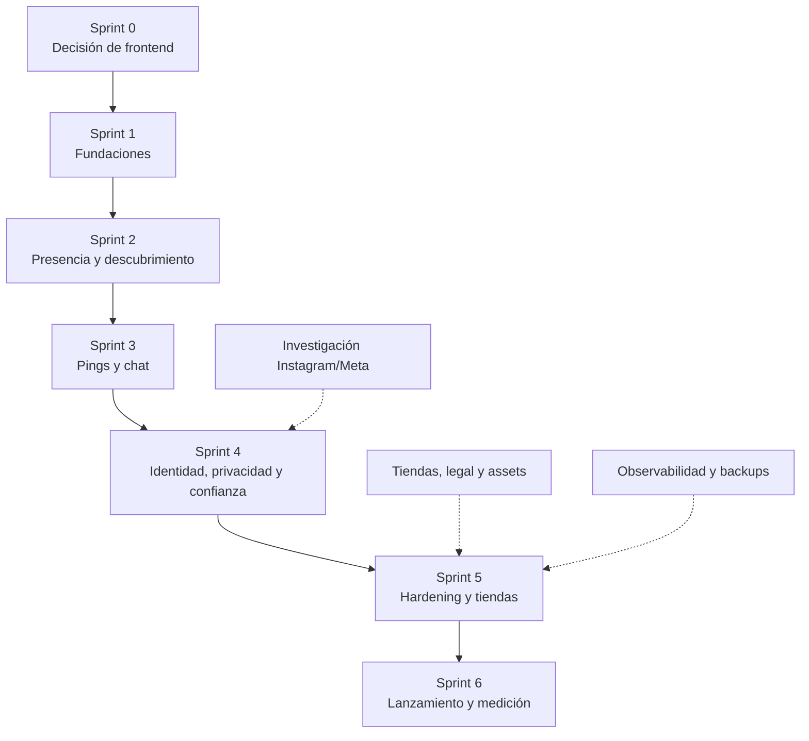

# Plan de sprints y features — MVP NearbyIG

> **Alcance:** todas las capacidades de la descripción original del cliente. No incluye fechas, horas ni duraciones.
> **Unidad de avance:** sprint cerrado con demo verificable en dispositivos.
> **Costo:** solo operación (infraestructura y servicios). No incluye desarrollo, QA, moderación, soporte ni marketing.
> **Regla:** ninguna feature se considera terminada si no cumple su criterio de aceptación, tiene autorización backend y se probó en un dispositivo real.

---

## 1. Principios del plan

1. **Primero se elige el frontend, después se construye.** El Sprint 0 compara Flutter y Expo con el mismo radar y datos simulados. Sin esa decisión no se escribe la app definitiva.
2. **Un solo backend modular.** NestJS con módulos de cuentas, perfil, presencia, descubrimiento, conexiones/chat, medios y confianza. Nada de microservicios en el MVP.
3. **Las dependencias mandan.** No se empieza una feature si su prerequisito no está cerrado. La tabla de dependencias es el contrato.
4. **Cada sprint termina con algo que el cliente puede ver y tocar.** No se reporta “avance porcentual”: se muestra un flujo real.
5. **El costo operativo no depende del sprint.** Depende de usuarios activos, mapas, almacenamiento y horas de uso. Durante la construcción se usa el stack de piloto.

---

## 2. Orden macro

**Camino crítico:** Sprint 0 → Sprint 1 → Sprint 2 → Sprint 3 → Sprint 4 → Sprint 5 → Sprint 6.

**Trabajo paralelo desde el Sprint 1:** cuentas de tienda, privacidad/términos, assets, observabilidad y la investigación de verificación de Instagram. No bloquean el código, pero sí bloquean la publicación.

---

## 3. Catálogo de features

| ID | Feature | Incluye | Depende de | Sprint |
|---|---|---|---|---|
| **F0.1** | Especificación común del radar | Diseño, datos simulados, criterios de aceptación y métricas para comparar Flutter y Expo. | — | 0 |
| **F0.2** | Spike Flutter | Radar animado, lista, detalle y navegación básica con datos mock. | F0.1 | 0 |
| **F0.3** | Spike Expo/React Native | El mismo alcance que F0.2, con datos mock. | F0.1 | 0 |
| **F0.4** | Demos en GitHub Pages | Publicación estática de ambos spikes con el mismo dataset. | F0.2, F0.3 | 0 |
| **F0.5** | Builds y scorecard | Build instalable Android/iOS, prueba en dispositivos, matriz de decisión y elección del cliente. | F0.2, F0.3, F0.4 | 0 |
| **F1.1** | Repo, CI y secretos | Sacar el ZIP con keystore del historial, branch protection, CI, entornos y secretos fuera del repo. | F0.5 | 1 |
| **F1.2** | Esqueleto backend | NestJS modular, Docker Compose con PostGIS, migraciones, health checks y configuración por entorno. | F1.1 | 1 |
| **F1.3** | Cuenta y acceso | Registro/login con Apple, Google o email; sesión; eliminación de cuenta; gate 18+; consentimiento legal. | F1.2 | 1 |
| **F1.4** | Perfil e intenciones | Nickname, fotos, estado, las 4 intenciones (networking, amistad, citas, actividades), género y audiencia. | F1.3 | 1 |
| **F1.5** | Medios | Subida, compresión, variante desenfocada, almacenamiento S3/R2 y URLs firmadas. | F1.4 | 1 |
| **F1.6** | Operación base | Logs, errores, uptime, backups, restore probado, alertas de presupuesto y feature flags. | F1.2 | 1 |
| **F2.1** | Presencia y ubicación | Actualización foreground, fila vigente por usuario, vencimiento, invalidación por pausa y **sin historial de ruta**. | F1.4 | 2 |
| **F2.2** | Descubrimiento geoespacial | Búsqueda por radio con PostGIS, distancia, filtros de visibilidad/intención/género y bloqueos. | F2.1 | 2 |
| **F2.3** | Radar | Anillos, barrido, puntos relativos, distancia, estados vacío/cargando/error. | F2.2 | 2 |
| **F2.4** | Mapa, lista y radio | Mapa con posiciones aproximadas, lista por distancia y radio configurable de metros a kilómetros. | F2.2 | 2 |
| **F2.5** | Visibilidad y privacidad | Modo fantasma/pausa con un switch, audiencia, desenfoque y reglas de revelación. | F2.1, F1.4 | 2 |
| **F2.6** | Permisos de ubicación | Explicación, permiso denegado, ubicación aproximada y enlace a ajustes. Nunca inventar una ubicación. | F2.1 | 2 |
| **F3.1** | Envío de Ping | Saludo/emoji, límite de frecuencia, idempotencia, vencimiento y verificación de bloqueo. | F2.2 | 3 |
| **F3.2** | Bandeja y match | Recibir, aceptar, rechazar, contra-ping y máquina de estados del match. | F3.1 | 3 |
| **F3.3** | Chat en tiempo real | Conversación autorizada por match, texto, lectura, paginación y expiración aplicada en acceso. | F3.2 | 3 |
| **F3.4** | Notificaciones | Push FCM/APNs, aviso visual/sonoro/háptico, deep link a ping/chat y permiso de notificaciones. | F3.1, F3.2, F3.3 | 3 |
| **F3.5** | Seguridad del chat | Reportar/bloquear desde la conversación, límites anti-spam y hook de moderación. | F3.3 | 3 |
| **F4.1** | Instagram y redes | Validación de usuario, enlace profundo, visibilidad solo con consentimiento y enlaces adicionales opcionales. | F1.4 | 4 |
| **F4.2** | Verificación social | OAuth para cuentas Business/Creator cuando sea posible; revisión manual con código en bio como fallback; estado del badge. | F4.1 | 4 |
| **F4.3** | Revelación mutua de fotos | Foto desenfocada hasta que ambas partes revelan; registro de consentimiento. | F2.5, F3.2 | 4 |
| **F4.4** | Bloqueo, reporte y moderación | Lista de bloqueos, motivos de reporte, evidencia, cola de moderación y tolerancia cero. | F3.3 | 4 |
| **F4.5** | Consola de administración | Reportes, suspensión de usuarios, revisión de verificación y auditoría. | F4.4 | 4 |
| **F4.6** | Centro de privacidad | Explicación de ubicación, consentimiento, eliminación de cuenta/datos y política de retención. | F1.3, F1.4 | 4 |
| **F5.1** | Matriz de QA | iOS/Android, pantallas, permisos, red lenta, offline, zonas horarias y accesibilidad. | F4.6 | 5 |
| **F5.2** | Revisión de seguridad | Autorización por endpoint, IDOR, límites de frecuencia, fuga de PII/ubicación, dependencias y secretos. | F4.6 | 5 |
| **F5.3** | Cumplimiento de tiendas | Privacidad, términos, eliminación de cuenta, data safety, rating 18+, evidencia de moderación, iconos y capturas. | F1.3, F4.2, F4.4 | 5 |
| **F5.4** | Performance y batería | Fluidez del radar, cadencia de ubicación, peso de imágenes, arranque en frío y consumo. | F2.3, F2.4, F3.3 | 5 |
| **F5.5** | Beta distribuida | TestFlight, Play Internal Testing, crash reporting y canal de feedback. | F5.1, F5.2, F5.3 | 5 |
| **F5.6** | Observabilidad y runbook | Dashboards, alertas, SLOs, alertas de costo y plan de incidentes. | F1.6, F5.1 | 5 |
| **F6.1** | Rollout escalonado | Feature flags, porcentaje de usuarios, kill switches y rollback. | F5.5 | 6 |
| **F6.2** | Métricas de producto | Activación, tiempo al primer ping, aceptación, inicio de chat, retención y costo por DAU. | F5.6 | 6 |
| **F6.3** | Feedback y soporte | Canal in-app, soporte, SLA de moderación y loop de correcciones. | F5.5 | 6 |
| **F6.4** | Revisión de costo y escala | Umbrales para subir API/base, agregar Redis o evaluar migración. | F6.2 | 6 |
| **F6.5** | Correcciones post-lanzamiento | Bugs críticos, ajustes de permisos, notificaciones y estabilidad. | F6.1 | 6 |

---

## 4. Sprints: objetivo, demo y costo

| Sprint | Objetivo | Features | Qué ve el cliente al cerrar | Costo operativo/mes |
|---|---|---|---|---:|
| **0** | Elegir frontend con datos, no con feeling. | F0.1–F0.5 | Dos demos en Pages, dos builds instalables, scorecard comparativo y decisión documentada. | **US$ 0–50** |
| **1** | Tener una base real de cuenta, perfil y operación. | F1.1–F1.6 | Registro, perfil con fotos, intención elegida, backend desplegado y restore de backup probado. | **US$ 30–60** |
| **2** | Convertir ubicación en descubrimiento. | F2.1–F2.6 | Dos teléfonos se ven en radar/mapa/lista con distancia y filtros; modo fantasma oculta al instante; sin coordenadas expuestas. | **US$ 30–60** |
| **3** | Cerrar el flujo de conexión. | F3.1–F3.5 | Un usuario envía ping, el otro acepta, se abre el chat, llega la notificación y se puede bloquear/reportar. | **US$ 30–60** |
| **4** | Resolver identidad, privacidad y confianza. | F4.1–F4.6 | Instagram vinculado/verificado con sus límites, revelación mutua de fotos, cola de moderación y centro de privacidad. | **US$ 30–60** |
| **5** | Preparar la app para tiendas y beta. | F5.1–F5.6 | Build en TestFlight/Play Internal, informe de QA/seguridad, ficha de tienda y runbook. | **US$ 30–60** |
| **6** | Lanzar y medir. | F6.1–F6.5 | Rollout, dashboards, primeros usuarios reales, métricas y decisión de escalar. | **US$ 30–60** en piloto |

**Aclaración:** el costo no se paga “por sprint”. Se paga por capacidad. Mientras haya hasta ~500 MAU / 50 DAU, el stack de piloto alcanza. Al crecer:

| Etapa | Usuarios | Costo/mes |
|---|---:|---:|
| Sprint 0 | 0 | US$ 0–50 |
| Construcción y beta | ≤500 MAU / 50 DAU | US$ 30–60 |
| Crecimiento | ~10.000 / 1.000 | US$ 75–200 |
| Escala | ~50.000 / 5.000 | US$ 350–550 |
| Escala con alta disponibilidad | ~50.000 / 5.000 | US$ 600–1.200 |

---

## 5. Dependencias que no se pueden saltear

| Si falta esto… | No se puede hacer esto | Por qué |
|---|---|---|
| F0.5 (frontend elegido) | F1 completo | Se construiría dos veces o se elegiría sin datos. |
| F1.3 (cuenta) | Perfil, pings, chat, moderación | Todo necesita identidad y autorización. |
| F1.4 (perfil e intención) | Presencia y descubrimiento | Sin intención y visibilidad no hay filtros ni candidatos. |
| F2.1 (presencia) | Radar, mapa, lista | No hay quién mostrar ni distancia que calcular. |
| F2.2 (descubrimiento) | Pings | Un ping necesita un candidato cercano y autorizado. |
| F3.3 (chat) | Reportes desde chat y revelación mutua | No hay conversación que moderar ni contexto de match. |
| F4.4 (bloqueo/reporte) | Publicación en tiendas | Apps sociales/UGC requieren herramientas de seguridad. |
| F5.3 (cumplimiento) | Beta y producción | Sin privacidad, eliminación de cuenta y rating, las tiendas rechazan. |
| Apple/Google verificados | TestFlight/Play Internal | Sin cuentas de organización activas no hay distribución. |
| Keystore nuevo | Firma Android | El del prototipo está comprometido; no se reutiliza. |

---

## 6. Qué NO entra en este MVP

No están en la descripción original del cliente. Si se quieren, entran como cambio de alcance:

- Premium, suscripciones, Founder Pass o pagos dentro de la app.
- “Quién vio mi perfil”.
- Sistema de referidos.
- Historial de encuentros.
- Web/PWA con paridad de producto.
- Ubicación en segundo plano (salvo que se confirme como requisito).
- Eventos, grupos, videollamadas, notas de voz o matching con IA.
- Redes sociales adicionales más allá de Instagram.

**Nota:** la intención “Actividades/Hobbies” sí está incluida; lo que no está incluido es un sistema de eventos o grupos.

---

## 7. Riesgos por sprint

| Riesgo | Sprint donde aparece | Mitigación |
|---|---|---|
| El radar se ve distinto o lento en Flutter/Expo | 0 | Mismo dataset y mismos criterios; builds en dispositivos, no solo web. |
| Fuga de ubicación o triangulación | 2 | Autorización backend, distancia calculada en servidor, sin coordenadas ajenas y límites de frecuencia. |
| Notificaciones que no llegan en background | 3 | Probar FCM/APNs en dispositivos reales y documentar límites por plataforma. |
| Verificación de Instagram no cubre cuentas personales | 4 | OAuth para Business/Creator + revisión manual como fallback; comunicar que no es verificación de identidad. |
| Rechazo de tienda por UGC/dating | 5 | 18+, bloqueo, reporte, moderación, privacidad y eliminación de cuenta antes de submission. |
| Densidad insuficiente de usuarios | 6 | Métricas por zona, lanzamiento concentrado y feedback; no inflar con perfiles falsos. |
| Costo de mapas web | 2–6 | SDK móvil; si se usa web, presupuesto separado y límites. |

---

## 8. Definición de terminado

Una feature se cierra cuando:

- [ ] Cumple su criterio de aceptación y se probó en un dispositivo real.
- [ ] Tiene autorización backend; no depende de filtros de interfaz.
- [ ] Tiene pruebas unitarias/integración donde aplique.
- [ ] No expone coordenadas, secretos ni datos privados.
- [ ] Tiene logs, errores y métricas mínimas.
- [ ] Está documentada para operación y soporte.
- [ ] Se puede demostrar en el cierre del sprint.

---

## 9. Recomendación de secuencia

1. **Sprint 0 primero, sin atajos.** La decisión de frontend condiciona todo.
2. **Sprint 1 y 2 son la base.** Sin cuenta, perfil, presencia y descubrimiento no hay producto.
3. **Sprint 3 es el corazón del valor.** Ping → aceptación → chat es lo que el cliente quiere probar.
4. **Sprint 4 no es “extra”.** Sin identidad social, privacidad y moderación, la app no pasa una revisión seria de tiendas.
5. **Sprint 5 es obligatorio antes de usuarios reales.** QA, seguridad y cumplimiento no se pueden comprimir.
6. **Sprint 6 es lanzamiento controlado.** Primero medir, después escalar.
